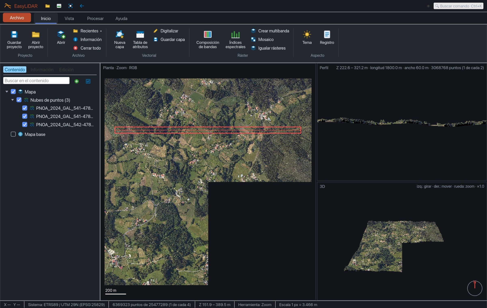
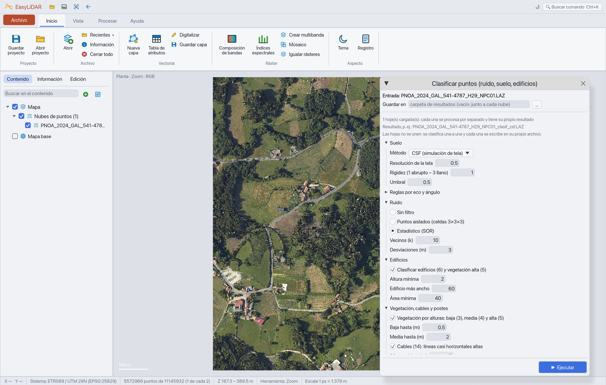
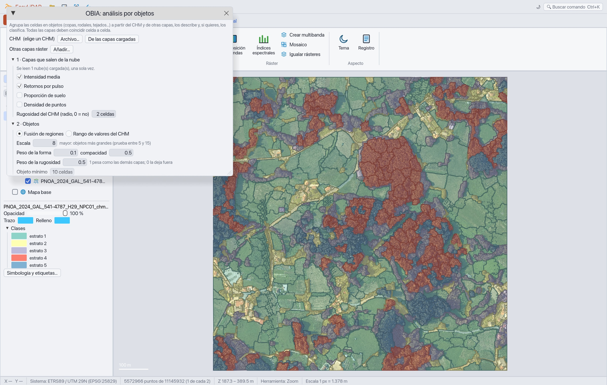
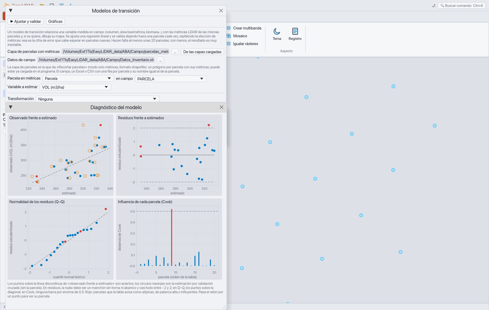
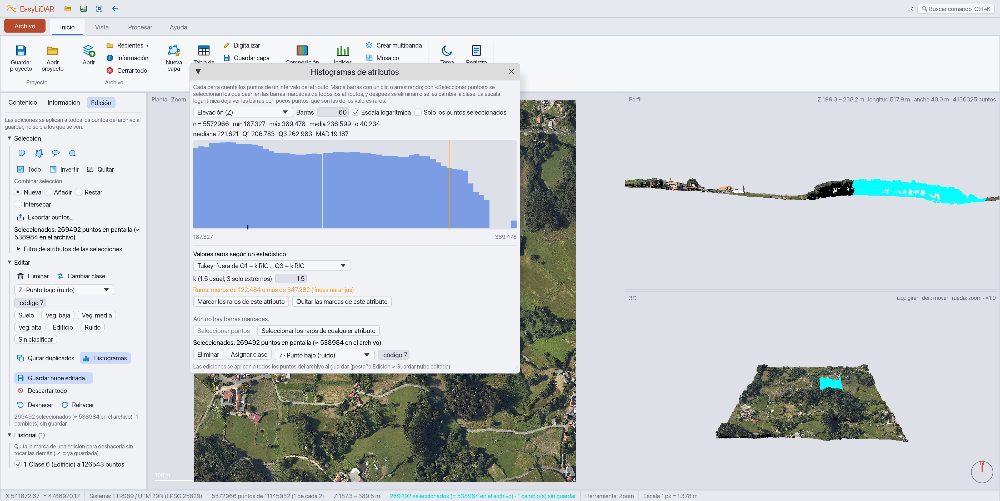
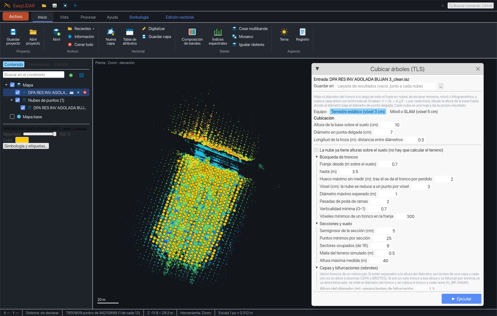
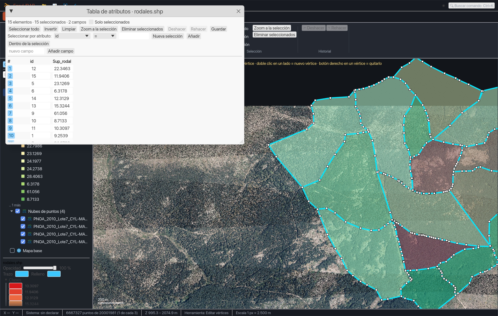
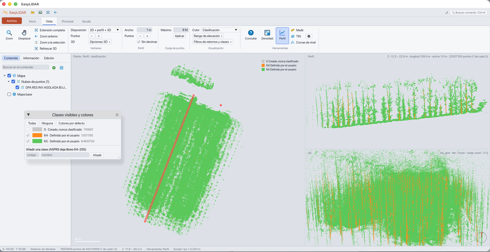

<p align="center">
  
</p>

<h1 align="center">EasyLiDAR</h1>

<p align="center">
  <strong>Procesamiento y edición de nubes LiDAR para forestales</strong><br>
  Rápido, ligero con nubes enormes y cómodo de editar. Windows, macOS y Linux.
</p>

<p align="center">
  <a href="https://github.com/juliomsevilla/EasyLiDAR/releases/latest"></a>
  
  
</p>

---

## Descargar

Ve a la página de **[Releases](https://github.com/juliomsevilla/EasyLiDAR/releases/latest)**, descarga el paquete de tu sistema (Windows, macOS Apple Silicon o Intel, Linux), descomprímelo y ejecuta `easylidar-gui` (en macOS, `EasyLiDAR.app`). No necesita instalador ni permisos de administrador.

**Primera vez que lo abres**

- **Windows:** si aparece el aviso azul de SmartScreen: *Más información → Ejecutar de todas formas*.
- **macOS:** abre `EasyLiDAR.app` (no abre ventana de Terminal). El programa no está firmado por un desarrollador que Apple conozca, así que la primera vez macOS lo bloquea: ábrelo una vez, ve a *Ajustes del Sistema → Privacidad y seguridad* y pulsa *Abrir igualmente*. Si descargas el paquete con el navegador, macOS marca también `easylidar` y `easylidar-gui` y los cierra al ejecutarlos desde la consola; se desbloquean con `xattr -dr com.apple.quarantine EasyLiDAR-macos-arm64` (o `-x64`) sobre la carpeta descomprimida, y si no arrancan: `chmod +x easylidar-gui easylidar`.
- **Linux:** `chmod +x easylidar-gui easylidar` si el archivo perdió el permiso. Hace falta GTK 3 para los diálogos de archivo y OpenGL 2 o superior (Mesa sirve).

---

## Qué hace

### Premisas

1. **Rapidez.**
2. **Eficiencia con nubes de puntos enormes:** los procesos leen la nube como un flujo y la memoria depende del área y de la celda, no del número de puntos. Los pasos locales trabajan por teselas en paralelo.
3. **Edición cómoda de nubes de puntos:** seleccionar, reclasificar y borrar con pocos clics, deshacer y rehacer, y ver el resultado al instante en planta, perfil y 3D.

### Visor y edición

- Ventanas **2D**, **2D + perfil**, **3D** y **2D + perfil + 3D**.
- Navegación 3D libre: giro sin tope, desplazamiento en el plano de la pantalla, zoom con la rueda, encuadre con doble clic.
- Colorear por elevación, clase, intensidad, retorno, pasada, archivo o RGB.
- **Edición por selecciones** (rectángulo, círculo, polígono, lazo, en planta, en perfil o **en la vista 3D**, con rebanada de profundidad y *Aislar selección* para editar un árbol a toda su densidad) con filtros por clase, altura, intensidad y retorno; eliminar o reclasificar; deshacer, rehacer e historial. El original nunca se modifica.
- **Histogramas de atributos** (elevación, intensidad, retornos, clase, pasada, ángulo de barrido): se marcan barras para seleccionar los puntos, o se detectan los valores raros con un estadístico (Tukey, MAD, desviaciones típicas, percentiles).
- **Proyectos (`.elp`):** guardan qué nubes y capas están abiertas, su orden, visibilidad, la vista y la orientación 3D, para retomar la sesión donde la dejaste.
- **Capas grandes sin colgarse:** las capas vectoriales pesadas se dibujan como una imagen (un shapefile de 41 mil objetos pasa de 4,5 GB a 233 MB) y se consultan con un índice espacial R-tree. Las nubes COPC se leen a más detalle, en segundo plano, al acercar el zoom.
- **Clases ASPRS 0–255:** la tabla vigente y clases nuevas propias (64–255) con nombre y color.

### Procesar

| Grupo | Herramientas |
|---|---|
| **Preparar** | **Clasificar**: ruido, suelo (Kraus y Pfeifer, MCC, CSF, PMF, SMRF, Axelsson), edificios, vegetación por estratos, cables y postes, reglas por eco y ángulo de barrido · Información de los datos · Asignar proyección · Exportar puntos · Adelgazar nube (densidad objetivo, celdas, percentil, 3D, uno de cada n) · Alturas sobre el suelo (atributo o nube normalizada) · Quitar duplicados · **Colorear con una imagen (RGB)** · **Normalizar la intensidad por distancia** · **Guardar como COPC** |
| **Calidad** | Comparar nubes (cambios) · Ajustar una nube a otra (ICP) · Separación entre pasadas |
| **Superficies** | MDT (triangulación por defecto, ponderado por distancia o media por celda, con **líneas de rotura**) · MDS / CHM (MDS por triangulación, ponderado por distancia o máximo por celda; CHM con *pit-free* y suavizado) · **Análisis de terreno** sobre el MDT: pendiente, orientación, sombreado, curvaturas, rugosidad, TRI, TPI, depresiones, acumulación de flujo, TWI, red de drenaje, subcuencas y cuenca visual · Volumen sobre (y bajo) el MDT, desde el CHM o el MDS, por ráster completo, AOI o polígonos |
| **Inventario forestal** | Métricas de rodal · Recortar parcelas (de archivo, muestreo o dibujadas) · Segmentar árboles (Dalponte, Silva, cuencas, ventana variable) con evaluación frente a campo · **Dendrometría TLS**: mide diámetros a lo largo del tronco, cubica con Smalian, estima la altura comercial de los fustes perdidos y guarda la nube con **fustes (clase 64) y ramas (clase 65)** para editarla · **Modelos de transición**: regresión de volumen, área basimétrica… sobre las métricas LiDAR, validada dejando una parcela fuera cada vez, y su mapa · Cambio forestal · Análisis por objetos (OBIA) |
| **Infraestructuras** | Corredores eléctricos |

### Ráster

- **Composiciones de bandas e índices espectrales** (NDVI, GNDVI, NDWI, EVI, SAVI, NDMI, NBR, VARI, ExG o expresión propia).
- **Igualar rásteres**: los pone sobre las celdas de uno de referencia para que coincidan celda a celda.
- **Crear multibanda** a partir de rásteres sueltos.
- **Mosaico** con regla de solape: primero, último, media, mínimo, máximo, mediana, suma o número de capas.
- **Cloud Optimized GeoTIFF multibanda**: mosaicos, imágenes multibanda y rásteres igualados salen en teselas con vistas reducidas, en JPEG (ortofotos) o sin pérdida; tres hojas de ortofoto PNOA ocupan 2,4 GB en vez de 14,7.
- **Lectura por ventana y escritura por franjas comprimidas**: se unen imágenes de varios gigabytes con poca memoria.

### Capas y formatos

LAS y LAZ (también **COPC**, leído solo en la parte que hace falta y escrito con *Guardar como COPC*), **PLY** y **E57** (se convierten a LAZ), ASCII, shapefile, **GeoJSON**, **GeoPackage** (lectura de varias tablas, cada una reproyectada desde su sistema, y **escritura** con índice R-tree, con escritor propio en Rust puro validado con SQLite y GDAL) y CSV. Rásteres: GeoTIFF (y **Cloud Optimized GeoTIFF**), **JPEG 2000** (las bandas de **Sentinel-2**, con lector propio en Rust que solo decodifica las teselas que se piden), PNG y JPEG con archivo de coordenadas, ENVI y SRTM `.hgt`. ECW y MrSID no se leen (ECW es propietario: se convierte antes con QGIS, GeoLibre o RustGis). Capas vectoriales con digitalización, tabla de atributos editable y simbología. **Mapa base** que se enciende y apaga desde el explorador de capas (OpenStreetMap, ortofoto PNOA, o un servidor propio de teselas).

<table>
  <tr>
    <td width="50%"></td>
    <td width="50%"></td>
  </tr>
  <tr>
    <td width="50%"></td>
    <td width="50%"></td>
  </tr>
  <tr>
    <td width="50%"></td>
    <td width="50%"></td>
  </tr>
  <tr>
    <td width="50%"></td>
    <td width="50%"></td>
  </tr>
</table>

<sub>Datos del PNOA LiDAR 2024 (© Instituto Geográfico Nacional, CC BY 4.0) y parcelas de campo propias.</sub>

---

## Manual

El manual completo está en [`docs/MANUAL.md`](docs/MANUAL.md) y dentro del programa: **Ayuda → Manual** o la tecla **F1**. La referencia de la línea de comandos está en [`docs/REFERENCIA.md`](docs/REFERENCIA.md).

## Línea de comandos

`easylidar` hace lo mismo que la interfaz, por lotes:

```sh
easylidar info nube.laz
easylidar thin nube.laz --method density --density 1
easylidar classify nube.laz --ground csf --noise isolated --buildings --vegetation
easylidar dtm nube.laz --cell 1
easylidar chm nube.laz --cell 0.5 --method pitfree
easylidar cubicar parcela_tls.laz --csv --tree-clouds --stem-classes
easylidar mosaic a.tif b.tif -o mosaico.tif --overlap mean
easylidar colorize nube.laz --image ortofoto.tif
easylidar copc nube.laz
easylidar import escaneo.e57 --epsg 25830
easylidar reproject nube_ed50.laz -o nube_etrs89.laz --to 25830
easylidar compare nube2.laz --reference nube1.laz --distance 0.5
```

`easylidar <comando> --help` lista todos los parámetros.

## Limitaciones conocidas

**Las coordenadas se pasan solas, pero solo en horizontal.** Cuando una herramienta combina archivos en sistemas distintos (por ejemplo una nube en ETRS89 UTM 30N con un MDT en 29N, o unas parcelas en ED50), EasyLiDAR **los pasa al sistema de la primera nube** y te lo dice en el informe. Las transformaciones coinciden con las de PROJ en todos los casos probados en España e incluyen las mallas oficiales del IGN y del ICGC para pasar de ED50 a ETRS89, que van dentro del programa.

- En el visor, las capas en otro sistema se pasan al de la primera nube al cargarlas (el registro avisa de que tardará más solo cuando hay capas en sistemas distintos).
- Qué se convierte: nubes LAS/LAZ y rásteres (copias temporales que se borran al terminar) y parcelas o muestras en shapefile o GeoJSON (en memoria, casi sin coste). Si todo está ya en el mismo sistema no se hace nada y no se pierde tiempo. El comando `easylidar reproject` convierte una nube o un ráster y guarda el resultado.
- **Solo cambian X e Y.** Las alturas se conservan tal cual: pasar de alturas elipsoidales a ortométricas (geoide) es otra operación y no se hace sola. Al reproyectar un ráster entre husos la celda se mantiene (por ejemplo 1 m) y los valores se interpolan; los rásteres de números enteros (clases) usan el vecino más cercano.
- Lo que no se convierte y sigue pidiendo que se haga antes: imágenes de varias bandas (ortofotos, satélite) y las herramientas de imágenes grandes (*Apilar*, *Mosaico* de imágenes e *Igualar rásteres*), que exigen el mismo sistema. Tampoco se pasan nubes desde o hacia coordenadas geográficas (grados).
- Si un archivo no declara su sistema no se puede comprobar, y el resultado lleva un aviso. ETRS89 y WGS 84 del mismo huso se consideran equivalentes y solo avisan, porque difieren en torno a un metro.
- Convertir una nube cuesta una pasada completa sobre ella, y su copia temporal ocupa espacio en disco. Si vas a trabajar mucho con ella, conviene convertirla una vez con `easylidar reproject` y guardar el resultado.

---

## Licencia

EasyLiDAR es de **uso gratuito**, también para trabajo profesional y comercial. No se puede modificar, vender ni redistribuir salvo en su paquete original y gratis. Las condiciones están en [`LICENSE`](LICENSE). Los componentes de terceros conservan sus licencias ([`NOTICE`](NOTICE), [`THIRD_PARTY_LICENSES.md`](THIRD_PARTY_LICENSES.md), [`licenses/`](licenses)).

### Aviso

EasyLiDAR está construido principalmente con [Claude](https://www.anthropic.com/claude), un modelo de IA de Anthropic, bajo dirección y revisión humanas. Sus resultados se contrastan con otros programas libres como FUSION, lidR, WhiteboxTools y GeoLibre, pero compruébalos para tu propio uso y, por favor, avisa de cualquier cosa que parezca incorrecta.

## Autoría y contacto

**Julio M. Sevilla**
✉ [julio@jsevilla.es](mailto:julio@jsevilla.es) · [LinkedIn](https://es.linkedin.com/in/juliomsevilla)

Se agradecen todas las aportaciones y la detección de errores (también en [Issues](https://github.com/juliomsevilla/EasyLiDAR/issues)). Los errores se irán corrigiendo en la medida de lo posible.
